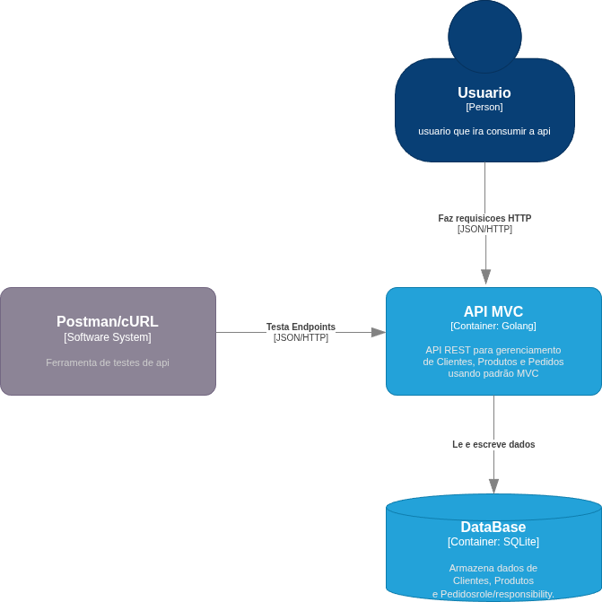
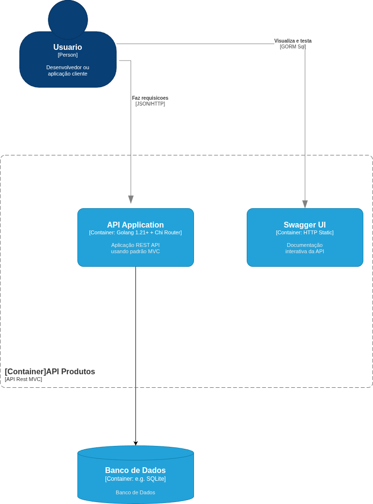
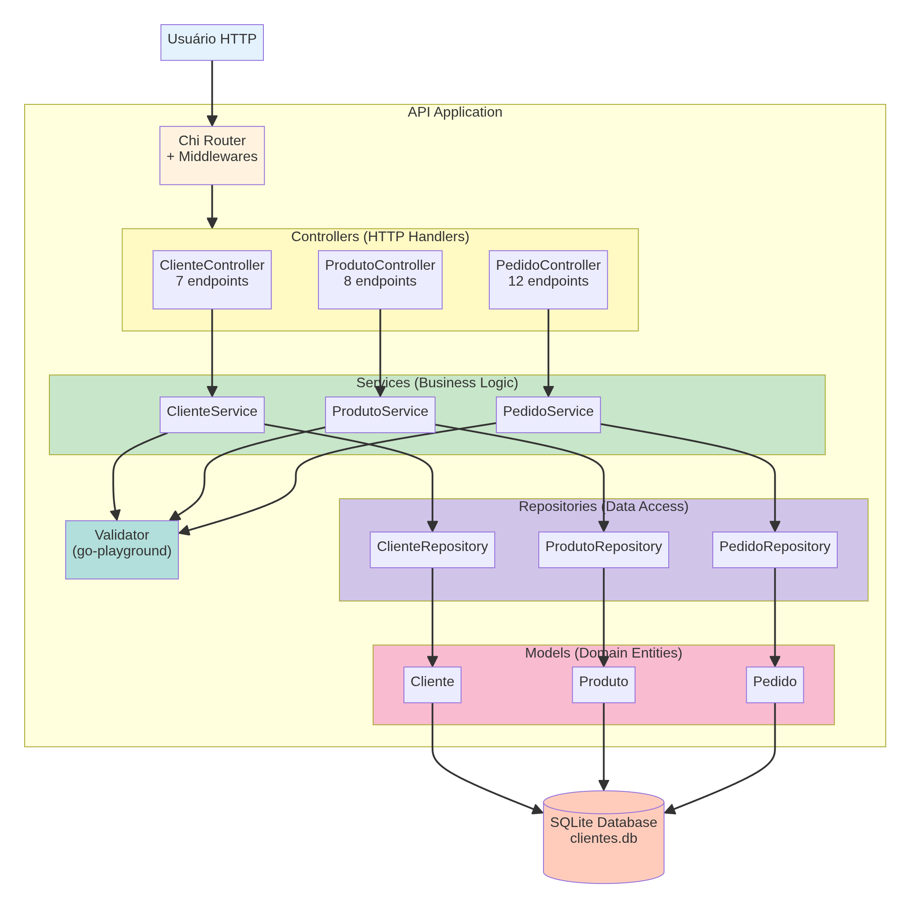
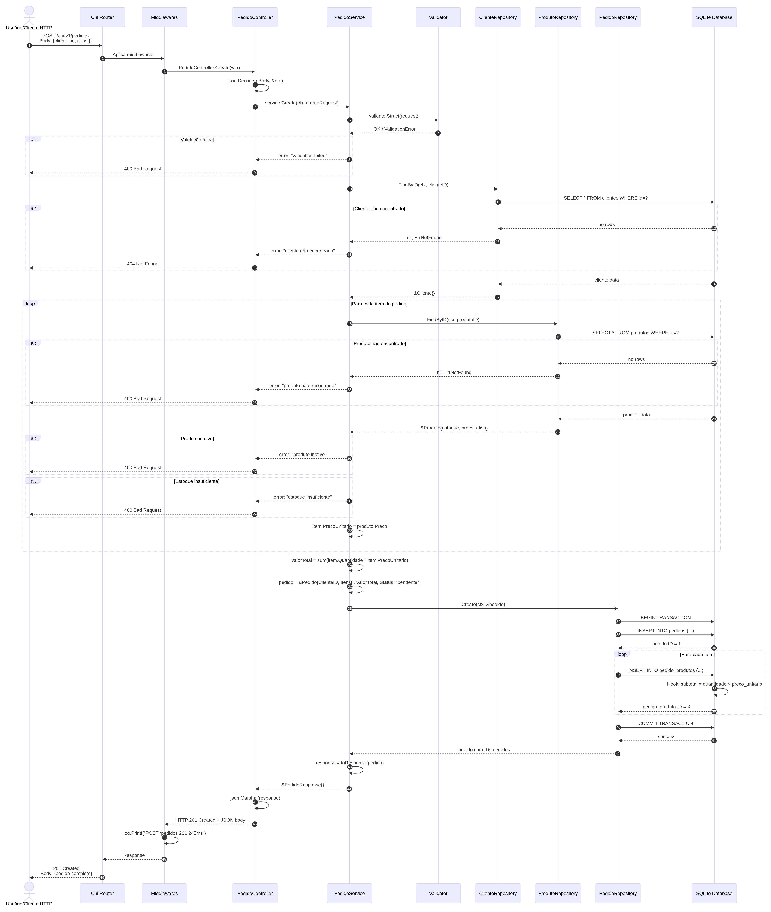
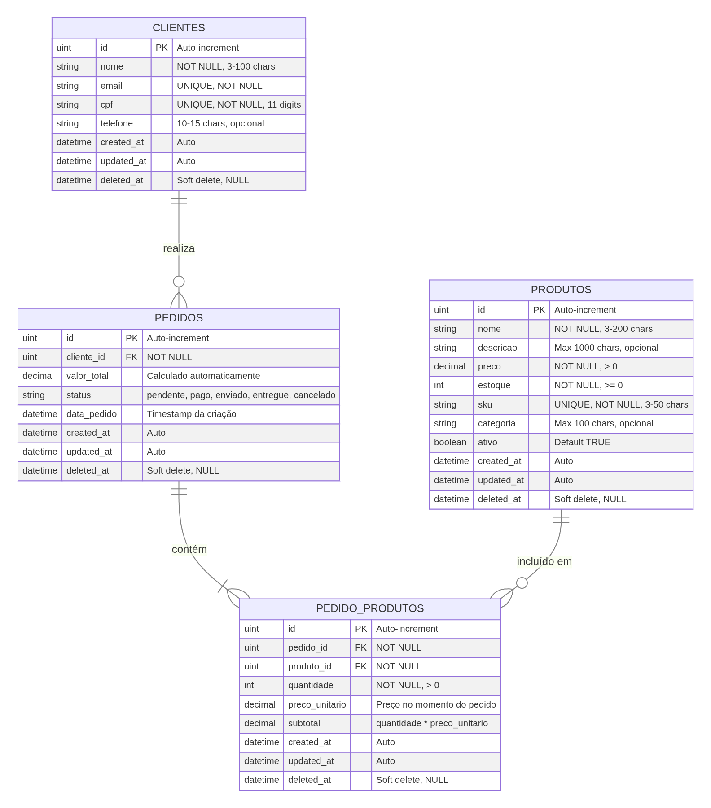

# API REST em Go — clientes, produtos e pedidos

> **Projeto de estudo e demonstração técnica.** API REST em Go com arquitetura em camadas e testes unitários e de integração com SQLite. O projeto não possui autenticação/autorização e não deve ser exposto publicamente sem controles adicionais.
>
> **Validação:** [Go CI](.github/workflows/ci.yml) executa análise estática, compilação e testes. Verifique o GitHub Actions para o resultado mais recente.


## Visão geral

API REST de demonstração para um domínio simplificado de comércio, com operações de clientes, produtos e pedidos. O foco está na separação entre handlers HTTP, regras de negócio e persistência, com testes e diagramas de arquitetura. Não se trata de um serviço implantado em produção.

## Casos de uso implementados

### Gerenciar Clientes
- Cadastrar novos clientes com nome, email, CPF e telefone
- Buscar clientes por nome ou ID
- Atualizar dados de clientes
- Remover clientes (soft delete - não apaga de verdade, só marca como inativo)

### Controlar Produtos
- Adicionar produtos com preço, estoque e categoria
- Atualizar informações e quantidade em estoque
- Buscar produtos por categoria ou nome
- Marcar produtos como ativos ou inativos

### Processar Pedidos
- Criar pedidos associando clientes e produtos
- Validar e baixar o estoque transacionalmente durante a criação do pedido (sem estorno automático no cancelamento)
- Calcular valor total do pedido
- Acompanhar status (pendente → confirmado → enviado → entregue)
- Cancelar pedidos quando necessário

## Como o projeto está organizado?

A API organiza responsabilidades em camadas. Os diagramas abaixo representam a estrutura documentada do projeto:



*Visão geral: como o sistema interage com usuários e o banco de dados*



*Dentro da aplicação: principais componentes e suas responsabilidades*

### Estrutura de Pastas

```
api/
├── cmd/api/                 # Ponto de entrada da aplicação
├── internal/
│   ├── controller/          # Handlers e contratos HTTP
│   ├── service/             # Regras de negócio e orquestração
│   ├── repository/          # Acesso à persistência
│   ├── model/               # Define as entidades (Cliente, Produto, Pedido)
│   ├── dto/                 # Formatos de dados para entrada/saída
│   └── middleware/          # Filtros e validações
├── config/                  # Configurações e conexão com o banco
├── docs/                    # Documentação automática (Swagger), collection do Postman para testes e 
                             # diagramas do projeto(c4 model, sequencia e er)
└── tests/                   # Testes automatizados
```


*Detalhamento: como os componentes internos se conectam*

## Padrões de Design (Design Patterns)

O projeto utiliza separação em camadas, interfaces e composição de dependências. Os nomes de padrões abaixo ajudam a analisar essas escolhas, mas não implicam que toda construção `New*` seja uma implementação canônica de um padrão GoF.

### Padrões Arquiteturais

**Arquitetura em Camadas**
- **Onde**: Estrutura completa do `internal/`
- **Por quê**: Separa responsabilidades em camadas (Controller → Service → Repository → Model)
- **Benefício**: Ajuda a limitar o acoplamento; mudanças nos contratos ainda podem afetar outras camadas

**MVC (Model-View-Controller)**
- **Onde**: `internal/controller/` (Controllers), `internal/model/` (Models), `internal/dto/` (Views/DTOs)
- **Por quê**: Organiza a aplicação separando lógica de apresentação, negócio e dados
- **Benefício**: Código mais organizado e fácil de manter

### Padrões de Criação

**Funções construtoras e composição (não necessariamente Factory Method GoF)**
- **Onde**: Funções `New*` como `NewClienteController()`, `NewClienteService()`, `NewClienteRepositorySQLite()`
  - `internal/controller/cliente_controller.go:17-21`
  - `internal/service/cliente_service_impl.go:20-26`
  - `internal/repository/cliente_repository_sqlite.go:15-18`
- **Por quê**: Centraliza a criação de objetos complexos
- **Benefício**: Centraliza a montagem e explicita dependências exigidas

### Padrões Estruturais

**Repository Pattern**
- **Onde**: Todo o `internal/repository/`
  - Interfaces: `cliente_repository.go`, `produto_repository.go`, `pedido_repository.go`
  - Implementações: `*_repository_sqlite.go`
- **Por quê**: Abstrai o acesso aos dados, isolando a lógica de persistência
- **Benefício**: Permite trocar o adapter de persistência sem mudar as interfaces de serviço, desde que o contrato e as semânticas do banco sejam preservados

**Adapter Pattern**
- **Onde**: Implementações de Repository (ex: `clienteRepositorySQLite`)
- **Por quê**: Adapta a interface genérica do repositório para o GORM
- **Benefício**: Desacopla a aplicação de detalhes de implementação do banco

**Composição centralizada de rotas**
- **Onde**: `internal/controller/router.go` (`SetupRouter`)
- **Por quê**: Mantém configuração de rotas e middlewares em um local identificável
- **Benefício**: Ponto único de configuração do servidor HTTP

**Decorator Pattern (Middleware)**
- **Onde**: `internal/middleware/middleware.go`
  - Logger, Recovery, ContentType
- **Por quê**: Adiciona funcionalidades (logging, recuperação de erros) sem modificar handlers
- **Benefício**: Funcionalidades transversais aplicadas de forma limpa

### Padrões Comportamentais

**Injeção de dependências por construtor**
- **Onde**: `cmd/api/main.go:44-61`
- **Por quê**: Injeta dependências via construtor em vez de criá-las internamente
- **Benefício**: Código altamente testável e com baixo acoplamento
```go
// Exemplo: Repositórios → Services → Controllers
clienteRepo := repository.NewClienteRepositorySQLite(db)
clienteService := service.NewClienteService(clienteRepo)
clienteController := controller.NewClienteController(clienteService)
```

**Interfaces de serviço e substituição de implementações**
- **Onde**: Interfaces de Service (`ClienteService`, `ProdutoService`, `PedidoService`)
- **Por quê**: Define contratos que permitem trocar implementações e usar doubles de teste
- **Benefício**: Fácil criar implementações alternativas (ex: mock para testes)

**Chain of Responsibility**
- **Onde**: Cadeia de middlewares em `router.go:17-21`
- **Por quê**: Requisições passam por vários middlewares sequencialmente
- **Benefício**: Cada middleware processa e passa adiante
```go
r.Use(chimiddleware.RequestID)  // 1. Gera ID único
r.Use(middleware.Logger)         // 2. Registra log
r.Use(middleware.Recovery)       // 3. Recupera de panics
r.Use(middleware.ContentType)    // 4. Define Content-Type
```

**Mapeamento entre entidades e DTOs**
- **Onde**: Métodos `toResponse()` nos Services
  - `internal/service/cliente_service_impl.go:143-154`
  - `internal/service/pedido_service_impl.go:197-253`
- **Por quê**: Converte entidades de domínio (`model`) para DTOs de resposta
- **Benefício**: Controla exatamente quais dados são expostos pela API

### Padrões de Dados

**DTO (Data Transfer Object)**
- **Onde**: `internal/dto/`
  - `CreateClienteRequest`, `UpdateClienteRequest`, `ClienteResponse`
- **Por quê**: Separa modelos de domínio dos dados de entrada/saída da API
- **Benefício**: Validação e controle independentes, protege modelo interno

**Active Record Hooks (GORM)**
- **Onde**: `internal/model/pedido.go:48-52` - `BeforeSave()`
- **Por quê**: Executa lógica antes de salvar (ex: calcular subtotal)
- **Benefício**: Lógica de domínio próxima ao modelo

### Resumo das decisões de organização

| Prática | Onde aparece | Benefício e limite |
| --- | --- | --- |
| Arquitetura em camadas | `internal/controller`, `service`, `repository` | Separa responsabilidades; não elimina todo o acoplamento |
| Repository | `internal/repository/` | Encapsula detalhes de persistência atrás de contratos |
| Construtores e composição | Funções `New*()` e `cmd/api/main.go` | Monta dependências explicitamente; **não implica Factory Method GoF** |
| Injeção de dependências | Composição em `cmd/api/main.go` | Facilita substituições em testes |
| Middleware HTTP | `internal/middleware/` | Compõe tratamentos transversais na cadeia HTTP |
| DTOs | `internal/dto/` | Define contratos de entrada e saída independentes dos modelos de persistência |

Interfaces de serviço possibilitam substituir implementações, mas **não comprovam por si só o padrão Strategy**. Da mesma forma, a separação de controllers, services e modelos aqui é mais bem descrita como **arquitetura em camadas para API REST** do que como uma implementação canônica de MVC com uma camada de views.

## Fluxos documentados

### Exemplo: Criar um Pedido

A criação de um pedido percorre validações, persistência e atualização de estoque na transação descrita no ADR:



1. **Entrada:** cliente e itens (produtos e quantidades)
2. **Validação:** existência de cliente, produtos e estoque disponível
3. **Cálculo:** total a partir das quantidades e preços
4. **Persistência:** transação para pedido, itens e baixa de estoque
5. **Resposta:** identificador e valores do pedido

### Outros Fluxos

**Operações com Cliente:**

*Criar, buscar, atualizar e deletar clientes*

**Operações com Produto:**

*Gerenciar produtos e estoque*

**Outras Operações de Pedido:**

*Consultar, atualizar status, cancelar e gerar relatórios*

## Banco de Dados

A API usa SQLite (um banco de dados simples em arquivo) com a seguinte estrutura:


*Estrutura das tabelas e relacionamentos*

**Principais relacionamentos:**
- Um **Cliente** pode ter vários **Pedidos**
- Um **Pedido** pode ter vários **Produtos** (e vice-versa)
- Cada item do pedido guarda o preço no momento da compra (histórico)

## Execução local

### Pré-requisitos
- Go na versão indicada em `go.mod` (atualmente 1.25.5), com CGO e compilador C habilitados para SQLite
- Um terminal/console

### Passos

**1. Clonar o repositório**
```bash
git clone https://github.com/danmaciel/api.git
cd api
```

**2. Instalar dependências**
```bash
make install
# Ou: go mod download
```

**3. Configurar ambiente**

A aplicação lê variáveis de ambiente do processo; não carrega um arquivo `.env` automaticamente. No terminal, execute:
```bash
export SERVER_PORT=8080
export DB_FILE_PATH=./database/api.db
```

**4. Executar a API**
```bash
make run
# Ou: go run cmd/api/main.go
```

O servidor estará disponível em `http://localhost:8080` quando iniciar corretamente.

## Documentação Interativa

Depois de iniciar a aplicação, acesse:

**http://localhost:8080/swagger/index.html**

A página descreve os endpoints documentados e permite experimentar requisições em ambiente local.

## Exemplos de Uso

### Criar um Cliente
```bash
curl -X POST http://localhost:8080/api/v1/clientes \
  -H "Content-Type: application/json" \
  -d '{
    "nome": "Maria Silva",
    "email": "maria@example.com",
    "cpf": "12345678901",
    "telefone": "11999999999"
  }'
```

**Resposta:**
```json
{
  "id": 1,
  "nome": "Maria Silva",
  "email": "maria@example.com",
  "cpf": "12345678901",
  "telefone": "11999999999",
  "created_at": "2025-12-17T15:30:00Z"
}
```

### Criar um Produto
```bash
curl -X POST http://localhost:8080/api/v1/produtos \
  -H "Content-Type: application/json" \
  -d '{
    "nome": "Notebook Dell",
    "preco": 3500.00,
    "estoque": 10,
    "sku": "DELL-NB-001",
    "categoria": "Eletrônicos"
  }'
```

### Criar um Pedido
```bash
curl -X POST http://localhost:8080/api/v1/pedidos \
  -H "Content-Type: application/json" \
  -d '{
    "cliente_id": 1,
    "itens": [
      {
        "produto_id": 1,
        "quantidade": 2
      }
    ]
  }'
```

**Resposta:**
```json
{
  "id": 1,
  "cliente_id": 1,
  "cliente": {
    "id": 1,
    "nome": "Maria Silva",
    "email": "maria@example.com"
  },
  "itens": [
    {
      "id": 1,
      "produto_id": 1,
      "produto": {
        "id": 1,
        "nome": "Notebook Dell",
        "preco": 3500.00
      },
      "quantidade": 2,
      "preco_unitario": 3500.00,
      "subtotal": 7000.00
    }
  ],
  "valor_total": 7000.00,
  "status": "pendente",
  "data_pedido": "2025-12-17T15:35:00Z"
}
```

## Comandos Úteis

```bash
make help              # Ver todos os comandos disponíveis
make run               # Executar a aplicação
make test              # Rodar testes
make test-coverage     # Rodar testes com relatório de cobertura
make build             # Compilar a aplicação
make swagger           # Gerar documentação Swagger
make clean             # Limpar arquivos de build
```

## Tecnologias Utilizadas

| Tecnologia | Para que serve? |
|------------|-----------------|
| **Go** | Implementação da aplicação HTTP |
| **Chi Router** | Roteamento HTTP leve e flexível |
| **GORM** | Facilita operações com banco de dados |
| **SQLite** | Banco de dados local para demonstração e testes |
| **Swagger** | Documentação interativa da API |
| **Validator** | Validação automática de dados |
| **Testify** | Framework de testes |

## Principais Funcionalidades

- **Validação automática**: Dados são validados antes de serem salvos
- **Soft Delete**: Registros "deletados" ficam marcados, não são removidos
- **Relacionamentos**: Pedidos conectam clientes e produtos automaticamente
- **Status HTTP corretos**: 200 OK, 201 Created, 404 Not Found, etc.
- **CORS permissivo**: configuração de demonstração; não representa política de acesso segura
- **Logging HTTP**: middleware de logging para as requisições cobertas
- **Graceful Shutdown**: Encerra conexões de forma limpa
- **Testes automatizados**: Verificam cenários cobertos pelas suites existentes

## Endpoints Disponíveis

### Clientes (7 endpoints)
- `POST /api/v1/clientes` - Criar cliente
- `GET /api/v1/clientes` - Listar todos
- `GET /api/v1/clientes/{id}` - Buscar por ID
- `GET /api/v1/clientes/nome/{nome}` - Buscar por nome
- `GET /api/v1/clientes/count` - Contar total
- `PUT /api/v1/clientes/{id}` - Atualizar
- `DELETE /api/v1/clientes/{id}` - Deletar

### Produtos
- `POST /api/v1/produtos` - Criar produto
- `GET /api/v1/produtos` - Listar todos
- `GET /api/v1/produtos/{id}` - Buscar por ID
- `GET /api/v1/produtos/categoria/{cat}` - Buscar por categoria
- `GET /api/v1/produtos/count` - Contar total
- `PUT /api/v1/produtos/{id}` - Atualizar
- `DELETE /api/v1/produtos/{id}` - Deletar

### Pedidos
- `POST /api/v1/pedidos` - Criar pedido
- `GET /api/v1/pedidos` - Listar todos
- `GET /api/v1/pedidos/{id}` - Buscar por ID
- `GET /api/v1/pedidos/cliente/{id}` - Pedidos de um cliente
- `GET /api/v1/pedidos/status/{status}` - Filtrar por status
- `PUT /api/v1/pedidos/{id}` - Atualizar status
- `DELETE /api/v1/pedidos/{id}` - Cancelar pedido

### Utilitários
- `GET /health` - Verificar se a API está funcionando
- `GET /swagger/*` - Documentação interativa


## Decisões técnicas e limitações conhecidas

- **Separação em camadas:** controllers tratam HTTP, services concentram as operações e repositories isolam a persistência.
- **SQLite/GORM:** banco simples para estudo; AutoMigrate não substitui migrações versionadas em sistemas de produção.
- **Estoque e concorrência:** a criação de pedidos realiza baixa condicional de estoque e grava o pedido na mesma transação de banco, com testes de rollback e concorrência em SQLite com conexões serializadas. A API ainda não devolve estoque automaticamente em cancelamentos ou exclusões; também faltam testes de carga e de múltiplas conexões/processos. Consulte [ADR 0001](docs/adr/0001-consistencia-estoque.md).
- **Segurança:** não há autenticação/autorização e a política de CORS é permissiva; não expor a aplicação diretamente na internet.
- **Operação:** o repositório não demonstra deploy de produção, métricas ou tracing distribuído.
- **Testes:** a suite contempla sqlite em memória e httptest. O resultado efetivo deve ser consultado no GitHub Actions.

## Autor

**Danilo Maciel**

---

**Versão:** 1.0.0
**Data:** 17/12/2025
**Escopo:** laboratório de arquitetura em camadas, API REST e testes; sem autenticação ou implantação de produção.
